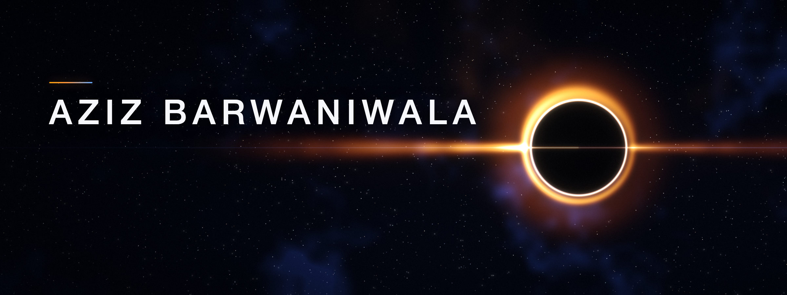

<b>Python Developer</b> · Backend engineering &amp; AI orchestration

  
  
  
  

  I build production backends and AI systems at <b>Primis Digital LLP</b>: 
  FastAPI, PostgreSQL, RAG and LLM orchestration. 
  Fun fact: I played football as a national-level striker.

## Stack

  <b>BACKEND &amp; DATA</b> 
  &nbsp;&nbsp;&nbsp;
  &nbsp;&nbsp;&nbsp;
  &nbsp;&nbsp;&nbsp;
  &nbsp;&nbsp;&nbsp;
  

  <b>AI</b> 
  &nbsp;&nbsp;&nbsp;
  &nbsp;
  &nbsp;
  &nbsp;
  

  <b>FRONTEND &amp; CLOUD</b> 
  &nbsp;&nbsp;&nbsp;
  &nbsp;&nbsp;&nbsp;
  &nbsp;&nbsp;&nbsp;
  &nbsp;&nbsp;&nbsp;
  &nbsp;&nbsp;&nbsp;
  

## Selected work

  
  

  
  

## Activity

  
  
  
  

  

## Certifications

**Anthropic** · [Claude Code 101](https://verify.skilljar.com/c/q32exff4hb5f) · [Claude 101](https://verify.skilljar.com/c/c8ak3bv56kov) · 2026 
**IBM** · [Introduction to Big Data with Apache Spark and Hadoop](https://coursera.org/share/1ac12aad53b6277b3e6f4b3e8c56f4ad) · 2025 
**Arizona State University** · [Machine Learning with Python](https://coursera.org/share/ea4c17bdf8beb3a5a58dafe8c7132c58) · 2024 
**NPTEL** · [Operating Systems](https://archive.nptel.ac.in/content/noc/NOC24/SEM2/Ecertificates/106/noc24-cs80/Course/NPTEL24CS80S43720320702648406.pdf) · 2024

Activity updates daily via GitHub Actions. Contributions is GitHub's count across all repositories, including private work for other organisations; commits, pull requests and repositories cover those I own, public and private. Profile views count page loads, not unique visitors.

